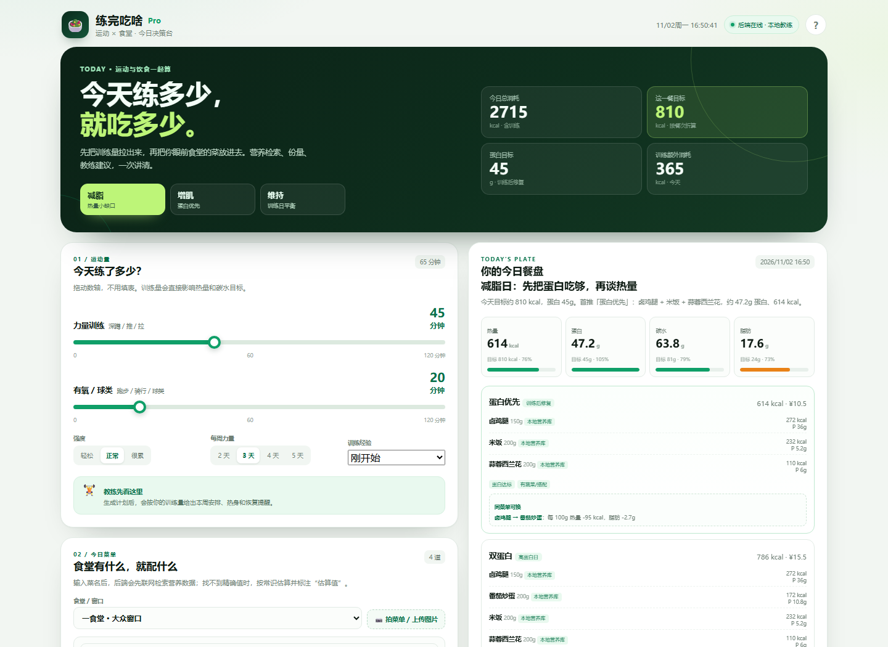

# 练完吃啥 Pro · 运动 × 食堂饮食决策台

> 正式版全栈项目：原生 HTML/CSS/JS 前端 + Node.js Express 后端 + 营养检索 + 菜单 OCR + 可选 DeepSeek 教练。  
> 不是“菜谱推荐器”，而是把 **今天的训练量 + 眼前食堂的菜 + 预算/忌口** 变成一个能执行的餐盘。

- 前端：`frontend/`（原生三件套，无框架、可直接 GitHub Pages）
- 后端：`backend/`（Express，Food 数据库 + 营养检索 + OCR + LLM 代理）
- 部署：GitHub Pages（前端）+ Vercel / Cloudflare Container（后端）
- 文档：[API 文档](docs/API.md) · [部署指南](docs/DEPLOYMENT.md)



---

## 1. 功能一览

### 运动侧（加强占比）

- **数轴式训练量调整**：力量训练 0–120 分钟、有氧/球类 0–120 分钟，拖动即更新热量目标；
- 强度（轻松/正常/很累）、每周力量天数、训练经验；
- 内置“教练”：
  - 按目标与天数生成本周训练安排（全身 / 上下肢 / PPL）；
  - 训练前热身、渐进超负荷、恢复与睡眠提醒；
  - 可与教练对话（配置 DeepSeek 时 AI 回答，未配置时本地教练兜底）；
- 运动消耗计入 TDEE，直接影响这一餐的热量和碳水目标。

### 饮食侧

- **先联网检索营养**：优先 Open Food Facts，查不到再回退本地营养库；
- **查不到就估算**：按菜名关键词 + 同类菜品常识估算，前端强制显示橙色“估算值”；
- 营养结果包含：热量、蛋白质、碳水、脂肪，以及来源/匹配名/备注；
- 支持输入份量（g）和价格，按份量折算；
- 3 套餐盘组合（蛋白优先 / 双蛋白 / 轻负担等），带：
  - 蛋白/碳水/热量/脂肪覆盖率；
  - 每道菜来源标签；
  - 同菜单替换建议；
  - 预算和忌口过滤；
- **菜单图片一键输入**：
  - 默认 OCR.space；
  - 失败自动回退本地 Tesseract.js（首次会下载中文语言包）；
  - 识别结果可编辑，确认后再查营养；
- 日期时间实时显示，生成结果带时间戳；
- 移动端适配；无横向溢出。

### 工程侧

- 前端 API 地址由 `frontend/config.js` 控制，GitHub Pages 构建时用 `API_BASE_URL` 注入；
- 后端 Key 只在服务端，前端永远拿不到；
- 营养缓存（SQLite）、计划记录、反馈记录；
- 请求限流、CORS 白名单、Helmet 安全头；
- 后端 9 项自动化测试（Node test + Supertest）；
- 没有 DeepSeek Key 也能完整生成计划与本地教练建议。

---

## 2. 目录结构

```text
sport-meal/
├── .github/
│   └── workflows/
│       └── deploy.yml              # GitHub Pages 自动构建 + 部署
├── frontend/
│   ├── index.html                  # 页面结构
│   ├── config.js                   # 本地 API 地址（同源留空）
│   ├── config.example.js           # 部署模板
│   └── assets/
│       ├── styles.css              # 视觉/响应式
│       └── app.js                  # 状态、API 调用、渲染、交互
├── backend/
│   ├── package.json
│   ├── package-lock.json
│   ├── .env.example
│   ├── server.js                   # 本地启动入口
│   ├── vercel.json                 # Vercel 路由
│   ├── api/
│   │   └── index.js                # Vercel Serverless 入口
│   ├── src/
│   │   ├── app.js                  # Express 应用、CORS/限流/静态托管
│   │   ├── config.js               # 环境变量
│   │   ├── db.js                   # node:sqlite 缓存/计划/反馈
│   │   ├── nutrition/
│   │   │   ├── database.js         # 本地营养库匹配
│   │   │   ├── online.js           # Open Food Facts 检索
│   │   │   ├── estimate.js         # 常识估算
│   │   │   └── lookup.js           # 联网→本地→估算 的回退链
│   │   ├── services/
│   │   │   ├── planner.js          # TDEE/组餐/替换/周训练计划
│   │   │   ├── llm.js              # DeepSeek 代理与本地教练
│   │   │   └── ocr.js              # OCR.space + Tesseract 回退
│   │   ├── routes/                 # health/foods/nutrition/plan/coach/ocr/feedback
│   │   └── utils/http.js
│   ├── data/
│   │   ├── foods.json              # 46 种常见食堂菜/食材，per100g
│   │   ├── nutrition-knowledge.md  # 运动营养知识库
│   │   └── app.db                  # 本地运行后生成，不提交
│   └── test/
│       └── api.test.js
├── scripts/
│   └── build-frontend.mjs          # 复制静态文件 + 注入 API 地址
├── docs/
│   ├── API.md
│   └── DEPLOYMENT.md
├── .gitignore
└── README.md
```

---

## 3. 本地运行

### 3.1 准备

- Node.js **22.5+**（需要内置 `node:sqlite`）
- npm

### 3.2 安装与启动

```bash
cd backend
cp .env.example .env
npm install
npm run dev
```

打开：

```text
http://127.0.0.1:3001
```

Express 会同时托管 `frontend/` 和 `/api`，所以本地不需要单独起前端服务器。

首次运行会生成 `backend/data/app.db`（营养缓存 / 计划 / 反馈）。

### 3.3 不配置 Key 也能跑

- 没有 `DEEPSEEK_API_KEY`：计划、营养、训练安排全部可用，教练使用本地规则；
- 没有 OCR.space key：默认使用公开演示 key `helloworld`，失败后自动回退 Tesseract.js；
- 没有外网：营养检索回退本地库/估算；核心流程不受影响（OCR 除外）。

### 3.4 常用命令

```bash
cd backend
npm test                 # 9 项 API/规则测试
npm run dev              # 监听文件变化
npm start                # 生产启动
```

---

## 4. 环境变量

复制 `backend/.env.example` 为 `.env`：

```bash
PORT=3001
FRONTEND_ORIGIN=http://localhost:3001,http://127.0.0.1:3001,http://127.0.0.1:5500

DEEPSEEK_API_KEY=
DEEPSEEK_BASE_URL=https://api.deepseek.com/v1
DEEPSEEK_MODEL=deepseek-chat

NUTRITION_ONLINE=true
OCR_PROVIDER=auto
OCR_SPACE_API_KEY=
OCR_SPACE_LANGUAGE=chs
DB_PATH=
```

完整清单见 [部署指南](docs/DEPLOYMENT.md#五环境变量总表)。

**安全：**
- `DEEPSEEK_API_KEY`、`OCR_SPACE_API_KEY` 只放在后端环境变量；
- 不要提交 `.env`、`app.db`、`node_modules`；
- 前端 `config.js` 只放公开的 API 地址，不放任何 Key；
- GitHub Actions 使用 `secrets.API_BASE_URL`，不是代码里的硬编码。

---

## 5. 核心实现说明

### 5.1 营养检索顺序

```
用户菜单
  ↓
1) SQLite 缓存（7 天）
  ↓ 未命中
2) Open Food Facts 联网检索（名称双字匹配 + 宏量营养素一致性校验）
  ↓ 无可靠结果
3) 本地营养库（精确/别名/模糊匹配）
  ↓ 无结果
4) 常识估算（关键词 + 同类菜品 + Atwater 回算）
  ↓
返回 source = online / local / estimated
```

- 前端对 `estimated` 强制显示“估算值”，并给出提示；
- 联网结果必须通过“名称匹配 + 宏量营养素与热量误差”校验，避免出现“番茄炒蛋匹配到番茄酱”的错误；
- 所有结果按份量（克）换算。

### 5.2 组餐与训练

- BMR：Mifflin-St Jeor；
- TDEE：BMR × 1.4 + 力量/有氧消耗；
- 目标：减脂 −400 kcal、增肌 +250 kcal、维持；
- 蛋白质：减脂 1.9 / 增肌 1.8 / 维持 1.6 g/kg；
- 每餐按早餐 25% / 午餐 35% / 晚餐 30% / 加餐 15% 折算；
- 组餐：蛋白菜 + 主食 + 蔬菜，支持双蛋白、轻负担/加量版；
- 训练：按每周 2–5 天生成全身 / 上下肢 / PPL 安排；
- LLM 只负责把已算好的事实讲顺，不让它生成营养数字。

### 5.3 菜单 OCR

- 默认 `OCR_PROVIDER=auto`：OCR.space → 失败 → 本地 Tesseract.js；
- 云端适合正式部署；本地 Tesseract 用于无 key / 云端不可用时兜底；
- Tesseract 首次运行会下载 `chi_sim` 语言包，之后会缓存；
- OCR 只负责“识别菜名”，营养仍需检索/估算；识别结果必须允许用户修改。

---

## 6. API

完整说明见 [docs/API.md](docs/API.md)。

| 方法 | 路径 | 说明 |
|---|---|---|
| GET | `/api/health` | 健康检查与能力开关 |
| GET | `/api/foods?q=` | 本地营养库搜索 |
| POST | `/api/nutrition/lookup` | 批量营养检索（联网→本地→估算） |
| POST | `/api/plan` | 生成餐盘 + 训练安排 + 可选 AI 文案 |
| POST | `/api/coach` | 教练问答（AI/本地） |
| POST | `/api/ocr/menu` | 菜单图片 OCR |
| POST | `/api/feedback` | 采纳/不合适反馈 |

示例：

```bash
curl -s http://localhost:3001/api/health

curl -s -X POST http://localhost:3001/api/nutrition/lookup \
  -H "Content-Type: application/json" \
  -d '{"items":[{"name":"番茄炒蛋","grams":200}],"online":false}'

curl -s -X POST http://localhost:3001/api/plan \
  -H "Content-Type: application/json" \
  -d '{
    "profile":{"sex":"male","age":20,"heightCm":175,"weightKg":68,"goal":"cut","experience":"beginner","daysPerWeek":3},
    "training":{"strengthMin":45,"cardioMin":20,"intensity":"mid"},
    "preferences":{"meal":"lunch","budget":15,"avoid":[]},
    "menu":{"canteen":"一食堂","items":[{"name":"米饭","grams":200},{"name":"番茄炒蛋","grams":200},{"name":"卤鸡腿","grams":150}]}
  }'
```

---

## 7. 前端配置与 GitHub Pages

### 7.1 本地

`frontend/config.js`：

```js
window.APP_CONFIG = {
  apiBaseUrl: "", // 同源：Express 同时托管前端和 API
  appName: "练完吃啥 Pro",
};
```

如果前端单独跑在 `5500`，改成 `http://127.0.0.1:3001`。

### 7.2 GitHub Pages

1. 推到 GitHub `main`；
2. Settings → Pages → Source 选 **GitHub Actions**；
3. Settings → Secrets → Actions 添加 `API_BASE_URL`（后端 HTTPS 地址）；
4. push 触发 `.github/workflows/deploy.yml`；
5. 在 Actions 看部署结果。

Workflow 会自动：

```
node scripts/build-frontend.mjs
# frontend/ -> dist/
# 写入 dist/config.js，apiBaseUrl = secrets.API_BASE_URL
# 上传 Pages artifact
# deploy-pages
```

手动构建：

```bash
node scripts/build-frontend.mjs
# 或
API_BASE_URL=https://your-api.vercel.app node scripts/build-frontend.mjs
```

**CORS 必须同步：**

```env
FRONTEND_ORIGIN=https://<用户名>.github.io
```

详细步骤和 Vercel / Cloudflare 部署见 [docs/DEPLOYMENT.md](docs/DEPLOYMENT.md)。

---

## 8. 后端部署（摘要）

### Vercel

- Root Directory：`backend`
- Build Command：留空 / Install：`npm install`
- 环境变量：`FRONTEND_ORIGIN`、`DB_PATH=/tmp/app.db`、可选 DeepSeek/OCR
- `vercel.json` 已配置重写到 `api/index.js`

```bash
cd backend
npx vercel --prod
```

### Cloudflare

Express 不能直接跑在 Workers V8 环境：

- **推荐**：Cloudflare Containers 运行 Docker 化的 Express；
- **纯 Workers**：改用 Hono，把 SQLite 换 D1、文件缓存换 KV、Tesseract 换云端 OCR；
- 详细对照和示例见 [docs/DEPLOYMENT.md](docs/DEPLOYMENT.md#四cloudflare-workers--containers)。

---

## 9. 数据与安全边界

- `foods.json` 是**参考估算库**，不是学校官方菜单；实际份量/做法会变化；
- 联网结果可能来自包装食品，与堂食做法不同；
- OCR 可能识别错字，必须让用户确认；
- 不提供疾病治疗、用药、极端节食建议；
- 过敏/疾病/进食障碍人群请咨询医生或注册营养师；
- 不承诺减重/增肌效果；
- 正式产品建议把营养库换成学校真实菜单 + 称重采样 + 营养师复核。

---

## 10. 提交规范

### 10.1 分支

```
main             # 可部署
feat/<topic>     # 新功能
fix/<topic>      # 修复
docs/<topic>     # 文档
chore/<topic>    # 构建/依赖
```

### 10.2 Commit message（Conventional Commits）

```text
feat: add strength/cardio range sliders
feat(api): support openfoodfacts fallback
fix(ocr): strip menu prices before parsing
docs: add GitHub Pages deployment guide
test: cover unknown food estimation
```

建议：
- 一个 commit 只做一件事；
- 不提交 `node_modules/`、`.env`、`app.db`、`dist/`；
- 改 API 时必须同步 `docs/API.md`；
- 改营养算法必须补测试；
- 改前端必须本地跑一次移动端宽度。

### 10.3 Pull Request 检查

- [ ] `cd backend && npm test` 通过；
- [ ] `node scripts/build-frontend.mjs` 成功；
- [ ] 本地页面能生成计划；
- [ ] 未提交任何 Key；
- [ ] API 变更已更新文档；
- [ ] 新增营养数据标明来源/估算方法。

### 10.4 比赛提交建议

提交包建议只放：

```
sport-meal/
├── frontend/
├── backend/
├── .github/workflows/deploy.yml
├── scripts/
├── docs/
├── README.md
└── .gitignore
```

不要放：`node_modules`、`.env`、`app.db`、本地截图、`dist`。  
答辩现场用本地 `npm run dev` 或已部署的 Pages 链接。

---

## 11. 已知限制 / 下一步

**限制：**

- 本地营养库只有 46 种常见菜，不是完整食堂菜单；
- Open Food Facts 对中式堂食覆盖有限，很多菜会回退到本地/估算；
- OCR 对复杂排版、手写菜单识别有限；
- Vercel + `/tmp` SQLite 不持久，正式产品需换 Postgres/D1/Turso；
- 没有用户账号、历史记录跨设备同步；
- 在线 LLM 的回答质量取决于模型，已做长度/医疗词校验和本地回退。

**下一步优先级：**

1. 接入学校真实菜单 + 连续 3 天称重采样；
2. 营养师复核 + 数据置信度；
3. 用户反馈（采纳/不合适）驱动排序；
4. 换持久数据库，补账号与历史；
5. 小程序 / 移动端拍照识别；
6. 食堂人流 / 排队数据；
7. 多学校数据后台。

---

## 12. 一句话

**先把今天的训练量和眼前这几道菜算清楚，再谈“健康饮食”。**
